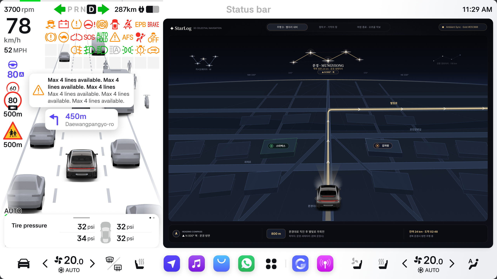
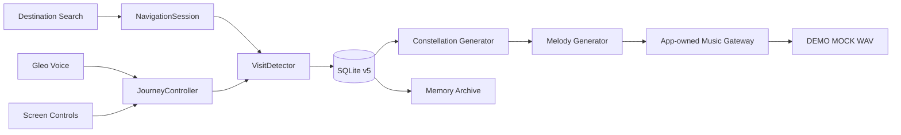

# ✦ StarLog

> 주행의 순간을 별자리와 음악으로 기록하는 Pleos Connect 차량 경험

StarLog는 목적지까지의 이동을 단순한 경로 기록이 아니라 **별, 별자리, 멜로디, 추억**으로
남깁니다. Gleo 음성으로 여행을 시작하고, 정차와 방문을 감지해 별을 만들며, 여행 종료 후
별자리의 기하를 음악으로 변환합니다.



> 위 이미지는 앱 UI와 시연 영상에 사용한 Figma 디자인(Pleos 전체화면 · 주행 D 별자리 내비)입니다.
> 앱은 같은 디자인으로 인트로 → 한반도 성단 → 주행 D → 정차 P 기억의 창 → 별자리 작성 → 오르골 악보 순서로
> 동작하며, 주행 데이터는 `DEMO REPLAY`, 음악은 `DEMO MOCK`으로 표시됩니다. 실제 실행 증거는
> `docs/team/STARLOG_E2E_DEMO_REPORT.md`와 시연 영상에서 구분해 제공합니다.

## 왜 StarLog인가

차량 내비게이션은 목적지에 도착하면 대부분의 역할이 끝납니다. StarLog는 이동 중 만난 장소와
머문 시간을 여행의 기억으로 연결해, **주행 이후에도 다시 보고 듣는 경험**을 만듭니다.

- 목적지 검색과 경로 안내
- 정차·방문 감지 및 중복 방지
- 왕복 여정 기반 별자리 생성
- 별자리 좌표 기반 멜로디 생성
- 사진과 음악을 연결한 여행 아카이브
- Gleo 한국어 음성 START / STATUS / END
- 앱 재실행 후 동일 여행 복원

## 서비스 사이클

```text
Gleo START
   ↓
목적지 검색 · 경로 안내 · 방문 감지
   ↓
여행 포인트 9개 → 고유 별 6개
   ↓
Gleo END → 별자리 완성
   ↓
별자리 회전 · 오선지 · 멜로디 확정
   ↓
DEMO MOCK 음악 생성 · 저장 · 재생
   ↓
사진 추억과 함께 SQLite에서 복원
```

## 핵심 화면

| 화면 | 역할 |
| --- | --- |
| StarLog Journey | 음성·화면이 공유하는 여행 상태, 기록 진행, 명시적 종료 |
| Navigation | 목적지 검색, Valhalla 경로, MapLibre 지도, 이탈·도착 처리 |
| Constellation | 왕복 방문을 별과 간선으로 투영하고 중복 귀환 별을 방지 |
| Melody Studio | 별자리 회전, 오선지 매핑, 유사도·자연스러움 평가, 멜로디 확정 |
| Memory Archive | 별별 사진 관계와 완료된 여행을 영속 저장·복원 |

## 아키텍처



화면 버튼과 Gleo는 동일한 `JourneyController`를 사용합니다. START, STATUS, END는 같은
`tripId`와 SQLite 파이프라인을 공유하며, 중복 START/END는 멱등적으로 처리됩니다.

## Gleo 공개 액션

공개 스키마는 Pleos 제한에 맞춰 정확히 세 개의 액션만 노출합니다.

| Action | 설명 |
| --- | --- |
| `CONTROL_STARLOG_JOURNEY` | `START`, `STATUS`, `END`로 여행 제어 |
| `PREPARE_CONSTELLATION_MUSIC` | 완료된 별자리의 편곡 설정과 사용자 확인 |
| `PLAY_CONSTELLATION_MUSIC` | 저장에 성공한 음악을 `silent` 콜백과 함께 재생 |

`OPEN_MELODY_STUDIO`는 Android 내부 호환 별칭이며 공개 액션이 아닙니다.

## 결정적 시연 시나리오

제출 시연은 `REPLAY`임을 UI와 데이터에 명확히 표시합니다.

| 불변식 | 결과 |
| --- | --- |
| 전체 여행 포인트 | 9 |
| 고유 별 | 6 |
| 출국 간선 | 4 |
| 복귀 신규 분기 | 1 |
| 일반 복귀 방문 | 기존 별 재사용 |
| 완료 방식 | 9번째 기록 후 명시적 END |

## 기술 스택

- Kotlin · Android API 34+
- Gradle 9.6 · Android Gradle Plugin 9.5.1 · Java 17
- Pleos Vehicle SDK 2.3.2
- MapLibre GL · Valhalla routing
- SQLite · WebView bridge
- Node.js deterministic music gateway
- JUnit4 · AndroidX Test · Espresso

## 저장소 구조

```text
app/src/main/java/com/example/starlog2/
├── contracts/       # 공통 DTO와 인터페이스
├── integration/     # 목적지·내비게이션·StarLog 연결
├── navigation/      # 경로, geometry, guidance, replay
└── starlog/
    ├── visit/       # 방문 감지
    ├── journey/     # START/STATUS/END 오케스트레이션
    ├── storage/     # 메모리·SQLite 저장소
    ├── melody/      # 별자리→멜로디 알고리즘
    ├── music/       # provider-neutral 음악 작업
    └── gleo/        # 액션·콜백 계약

backend/suno-gateway/ # 앱이 비밀을 소유하지 않는 음악 게이트웨이
fixtures/             # 공통 계약 golden fixture
tools/                # 결정적 검증 도구
docs/                 # 아키텍처·시연·검증·인수 기록
```

## 빌드와 실행

요구 사항: JDK 17+, Android SDK 37, API 34+ 실행 대상, Pleos Connect AVD, Node.js 20+.

```powershell
.\gradlew.bat :app:assembleDebug :app:lintDebug
adb install -r app\build\outputs\apk\debug\app-debug.apk
adb shell am start -n com.example.starlog2/.StarLogDemoActivity
```

음악 데모 게이트웨이:

```powershell
Set-Location backend\suno-gateway
$env:MUSIC_PROVIDER='mock'
npm test
npm start
```

Android 에뮬레이터는 호스트 게이트웨이를 `http://10.0.2.2:8787`로 접근합니다. 이 주소는 차량
환경에서 사용할 수 없습니다.

## 검증

- Kotlin/JVM 단위 테스트 164개 메서드
- Android instrumentation 테스트 23개 메서드
- Gleo 공유 여정 순수 사이클: `9 / 6 / 4 / 1`
- gateway idempotency·인증·WAV 다운로드 테스트
- SQLite migration, source namespace, 완료 상태 회귀 방지
- 목적지 latest-request-wins, 취소, timeout, 429, off-route, arrival

세부 검증과 실행 제한:

- [E2E 시연 가이드](docs/team/STARLOG_E2E_DEMO_GUIDE.md)
- [E2E 구현·검증 보고서](docs/team/STARLOG_E2E_DEMO_REPORT.md)
- [Gleo 여행 제어](docs/team/STARLOG_GLEO_JOURNEY_HANDOFF.md)
- [공통 인터페이스 계약](docs/INTERFACE_CONTRACTS.md)

## 정직한 시연 경계

- 제출용 주행 데이터는 `DEMO REPLAY`입니다.
- 현재 음악 provider는 `DEMO_MOCK`이며 실제 Suno 호출로 표현하지 않습니다.
- 실제 Suno adapter는 공식 인증 REST 계약, 비용 승인, rate limit과 미디어 정책이 확보되기
  전까지 fail-closed입니다.
- API key와 provider 비밀은 앱·Git·Gleo 콜백에 저장하지 않습니다.
- 차량 배포는 TLS 1.2 이상의 승인된 HTTPS 백엔드를 사용해야 합니다.

## 문서

- [팀 문서 인덱스](docs/README.md)
- [별자리 알고리즘](docs/constellation/algorithm-spec.md)
- [음악 게이트웨이](backend/suno-gateway/README.md)
- [G1 검증](docs/g1/VALIDATION.md)

---

**StarLog — Drive the route. Keep the constellation. Hear the memory.**
