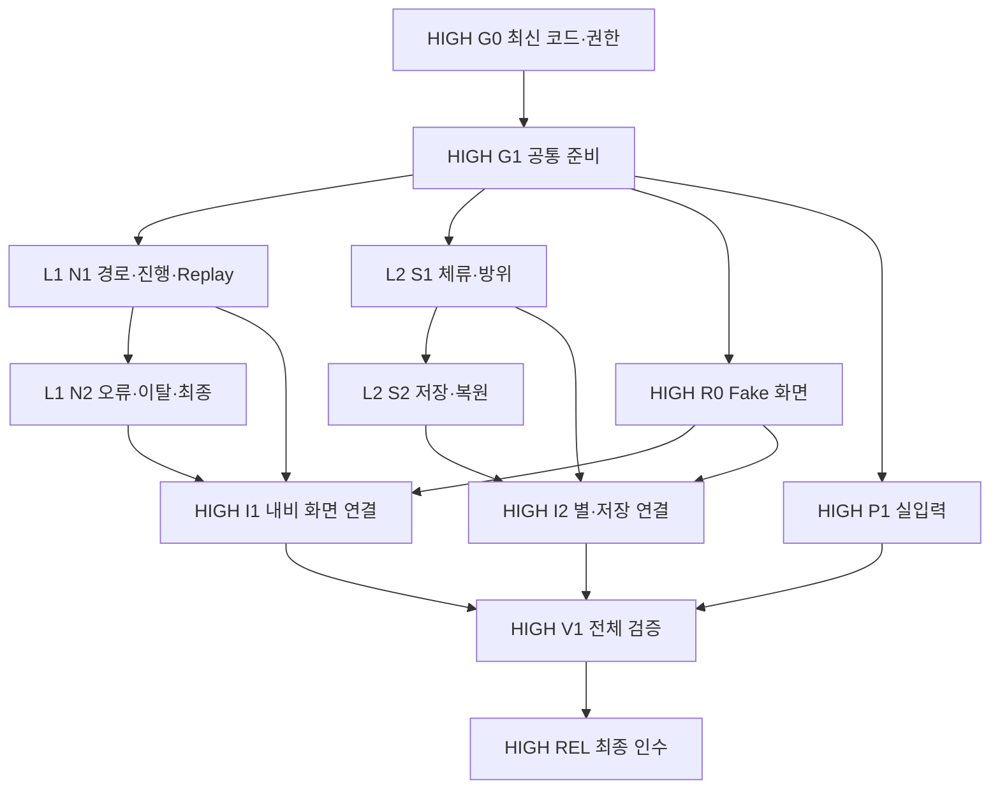

# StarLog 전체 완성까지 따라가는 워크플로우
운영 버전: three-pc-v3 · 갱신: 2026-11-10

[추정] 이 표는 **미리 정해 둔 실행 순서**다. 팀원이 칸을 채워 계획을 만드는 문서가 아니다. 실제 코드·검증 기록은 각 담당 AI가 Issue/PR에 작성한다.
[확실] HIGH=고사양 PC, L1=노트북1, L2=노트북2다. 이 페이지에서 전체 흐름을 보고, [장비별 경로](team/BOARD.md)에서 자기 작업을 확인한다.

## 1. 시작부터 최종 전달까지
| 단계 | 누가 시작하나 | 정확히 하는 일 | 누구에게 무엇을 전달하나 | 받는 쪽의 다음 행동 |
|---|---|---|---|---|
| ① 원본 준비 G0 | HIGH | 현재 원본과 GitHub를 비교하고 최신 소스·재현 빌드를 준비 | HIGH가 같은 기준의 코드와 빌드 결과를 준비 | HIGH가 공통 규격 작업으로 이동 |
| ② 공통 준비 G1 | HIGH | 연결 데이터 형식, 공통 테스트 입력, 실행 환경과 담당 작업을 실제로 준비·검증 | L1/L2에 준비 완료 공지와 시작 코드 버전·본인 작업 링크 | L1/L2 AI가 내려받아 확인하고 각각 ③ 시작 |
| ③-A 내비 개발 N1 | L1 | 경로 읽기·주행 진행·모의주행 구현·시험 | HIGH에 내비 코드 PR, 사용 예시, 재생 입력, 테스트 결과 | HIGH가 ④-A 지도 연결, L1은 N2 오류·이탈·도착 처리 보강 |
| ③-B 기록·방위 개발 S1 | L2 | 실제 체류 판정·정차 상태·방위별 별 선택 구현·시험 | HIGH에 StarLog 코드 PR, 입력 예시, 정차/방위 경계 시험 | HIGH가 ④-B 별·액자 연결, L2는 S2 저장·복원·중복 방지 보강 |
| ③-C 화면·차량 기반 R0/P1 | HIGH | 승인된 시험 입력으로 지도·표식·안내·하늘·액자 화면 구현, 실제 센서 지원 확인 | 자기 통합 작업에 화면 코드와 차량 지원표를 남김 | L1/L2 결과가 도착한 연결 작업부터 처리 |
| ④-A 내비 연결 I1 | HIGH | L1의 검토 통과 코드로 실제 지도 표식·카메라·다음 안내 연결 | L1에 연결 결과 또는 구체적인 오류/수정 요청 | L1은 실패 부분 수정·재시험·재전달 |
| ④-B 별·기록 연결 I2 | HIGH | L2의 검토 통과 코드로 하늘 별·정차 액자·저장·복원 연결 | L2에 연결 결과 또는 오류/수정 요청, 필요 시 DB 시험 결과 | L2는 실패 부분 수정·재시험·재전달 |
| ⑤ 실제 입력 연결 P1 | HIGH | 위치·방향·기어·속도의 지원 여부와 실제 callback 확인, 검증된 입력을 앱에 연결 | 해당 담당에게 실제 지원범위·입력 예시·결함 | L1/L2가 자기 도메인에서 실제 입력과 다른 가정을 수정 |
| ⑥ 전체 주행 검증 V1 | HIGH | 주행→별 표시→유효 정차 액자→이동 복귀→기록 저장→재실행 흐름 시험 | L1/L2에 자기 기능 오류, HIGH 화면 오류는 직접 수정 | 수정된 결과를 같은 PR/작업에서 재수신·재검증 |
| ⑦ 기획 기능 마무리 | HIGH가 범위 확인 후 세 장비 배분 | 합의한 시작 연출·일상 성단·종료 알림·여행 별자리/리캡·음향 등 남은 기획 기능 구현 | L1은 필요한 주행 이벤트, L2는 성단/여행 데이터, HIGH는 화면·차량·오디오 연결 | 변경된 흐름을 다시 전체 검증 |
| ⑧ 최종 시험 | HIGH | 정상·오류·권한 거부·데이터 없음·창 크기 변경·종료/재개·저장 복원 시험 | 실패는 담당 장비에 수정 요청, 성공은 검증 보고로 기록 | 필요한 시험이 모두 통과할 때까지 수정 반복 |
| ⑨ 최종 인수 REL | HIGH | 최종 코드/앱·실행 방법·검증 범위·남은 제약 정리, release PR | 사용자에게 최종 결과, 세 사람에게 최종 코드·실행 안내 | 합의한 필수 범위 통과와 최종 적용 승인 후 완료 |

[추정] ③-A/③-B/③-C는 병렬이다. HIGH 내부 작업은 한 컴퓨터에서 순차 수행한다. ④는 기능의 검토 가능한 중간 결과부터 시작할 수 있고, N2/S2 최종 보강 뒤 다시 검증한다.
[추정] ⑤의 실제 입력 지원이 막혀도 시험 입력 기반 연결·검증은 계속한다. 실제 주행이 필수 요구라면 실제 입력 검증 전에는 최종 완료로 처리하지 않는다.

## 2. 기획 기능의 “전체 완성” 범위
[확실] 기획에는 시작 연출, 일상 성단, 정차 기억 액자, 종료 알림, 여행 별자리/리캡, 사진 보정·대체, 퍼지 별자리, 차량 조명·에코·공간 음향 확장 등이 있다.
[추정] 지도와 별 한 번 표시로 전체 서비스 완성이라고 하지 않는다. HIGH AI가 공통 설계의 기능 목록을 Issue에 옮겨 사용자 합의 범위와 완료 여부를 기능별로 관리한다. 기능 목록 작성·전달은 AI의 업무다.
[불확실] 차량 카메라·계기판·조명·오디오·실입력의 실제 지원과 일부 제품 임계는 미확정이다. 합의되지 않은 기능을 임의로 삭제하거나 가능하다고 가정하지 않는다. 지원이 안 되는 필수 기능은 사용자 결정이 필요한 구체적 제약으로 보고한다.

## 3. 사람이 인수인계 문서를 직접 쓰나?
[추정] **아니다. 보내는 AI가 전달 내용을 작성하고, 받는 AI가 조회·검증·다음 작업을 수행한다.** 사람은 AI 작업을 시작/재개하고, 필요한 인증·기기 연결·제품 결정을 처리한다.
[추정] 예: L1 AI가 “내비 PR과 시험 결과 게시” → HIGH AI가 그 PR을 읽어 지도에 연결 → 실패하면 HIGH AI가 재현 절차 기록 → L1 AI가 그 기록을 읽고 수정한다.
[확실] 이 운영은 각 AI가 실행되고 GitHub에 접근할 때 이뤄진다. 자동 감시·메시지 중계·백그라운드 실행 시스템을 설치한 것은 아니다.

## 4. 막혔을 때
| 상황 | 다음 행동 |
|---|---|
| HIGH 공통 준비 전 | L1/L2는 환경·자료·시험 시나리오 준비. 공유 형식을 독자 확정하지 않음 |
| 내비 전달 전 | HIGH는 시험 입력 화면/센서 작업, L2는 자기 작업 계속 |
| 별·저장 전달 전 | HIGH는 화면/내비/센서 작업, L1은 자기 작업 계속 |
| 노트북에서 Pleos 시험 불가 | 노트북 AI가 시험 코드·명령·기대값을 보내고 HIGH AI가 실행·회신 |
| 연결 실패 | HIGH AI가 원본 PR에 실패 입력·기대/실제·수정 조건 기록, 담당 AI가 수정 |
| 데이터 형식 변경 필요 | HIGH AI가 영향과 새 기준을 정리·공지, 두 노트북 AI가 반영·시험 |
| 사람의 선택이 필요한 기능 | AI가 구현 가능한 대안과 영향으로 질문. 독립 작업은 계속 |

AI용 상세 절차: 작업 ID·검증 조건·코드 전달 기준

[추정] 아래는 위 v3 흐름을 실행할 기술 상세다. 사람의 빈 표 작성 절차가 아니라 담당 AI가 수행할 절차로 적용한다.

[확실] 대상은 고사양 PC 1대(HIGH_PC), 노트북 1(LAPTOP_1), 노트북 2(LAPTOP_2)다.
[추정] 이 문서는 합의한 장비 배치를 실제 실행할 단계와 통과 조건으로 풀어쓴 운영 기준이다. 장비별 고정 경로는 [작업 경로](team/BOARD.md), 실제 진행은 담당 Issue/PR, 전달 절차는 [인수인계](HANDOFF.md), 기본 규칙은 [협업 규칙](COLLABORATION.md)에서 확인한다.

## 1. 매번 여기부터
1. [추정] 사람과 AI 모두 작업 시작/재개 시 기본 브랜치의 README·WORKFLOW·장비별 경로와 본인 Issue의 최신 댓글을 읽는다.
2. [추정] 자신의 작업 ID·상태·선행 단계·인수인계 ID·승인 코드 SHA를 확인한다.
3. [추정] 선행 단계가 통과했으면 정해진 입력으로 시작한다. 선행이 안 됐으면 아래 독립 작업만 진행한다.
4. [추정] AI가 작업하거나 다른 장비에 전달할 때 Issue/PR에 근거를 남긴다. 다른 AI 대화의 자동 공유·상시 자동 감시를 전제하지 않는다.
5. [추정] 전달한 결과는 수신 장비의 RECEIVED와 검증 결과까지 확인한다. 보냈다는 이유만으로 다음 단계가 완료되지 않는다.

## 2. 기준 문서와 코드
[추정] 고정된 작업 경로는 master의 docs/team/BOARD.md, 실제 진행 현황은 Issue/PR 댓글을 기준으로 한다. 승인 코드·계약은 integration/starlog-v1의 BASELINE 기록과 해당 commit을 기준으로 한다. feature 브랜치의 오래된 BOARD 사본으로 현재 상태를 판단하지 않는다.
[추정] HIGH가 운영 문서 최신본을 integration에도 필요한 시점에 반영한다. 코드 병합에는 담당 기능 변경만 검토하고 오래된 운영 문서를 함께 덮어쓰지 않는다.
[추정] 사용자 제품 요구를 바꾸는 선택은 사용자 확인이 필요하다. 내부 데이터 계약·작업 순서 변경은 HIGH가 영향 분석 후 버전과 공지를 남긴다.

## 3. 단계별 실행·전달 표
[추정] “통과”는 지정된 증거와 수신 확인을 갖춘 상태다. 아래 순서는 운영 배치이며 실제 상태는 담당 AI가 Issue/PR에 기록한다.
| 작업 ID | 수행 컴퓨터 | 선행 조건 | 하는 일 | 다음 장비에 전달할 것 | 다음 장비/통과 조건 |
|---|---|---|---|---|---|
| G0 | HIGH | 최신 원본·저장소 접근 | 로컬/원격 비교, 사용자 변경 보존, 최신 코드 준비, 장비 권한 확인 | 준비 PR·기준 코드·빌드 결과·현재 제약 | HIGH가 코드 기준과 재현 빌드 확인 → G1 |
| G1 | HIGH | G0 통과 | 계약 코드/Clock/Fake/fixture/test harness, BASELINE, 담당 Issue 확정 | H-G1: 승인 BASE_SHA·계약 hash·세 Issue·필수 명령·통과 로그 | L1/L2가 동일 기준 내려받아 확인(RECEIVED) → 각각 N1/S1 |
| N1 | LAPTOP_1 | H-G1 수신·기반 검사 통과 | 경로 요청/파싱, geometry, Guidance 진행, Replay | H-N1: Draft 또는 기능 PR·공개 API 사용 예·route/replay fixture·단위/계약 결과 | HIGH 검토 통과 → R1의 실제 연결 가능; L1은 N2 계속 |
| N2 | LAPTOP_1 | N1 기능 기반 | 회전/이탈/도착/취소/오류·경계 보강 | H-N2: 최종 PR SHA·테스트·한계·연결 설명 | HIGH 기능 검토·병합/후속 반영 확인 → I1 |
| S1 | LAPTOP_2 | H-G1 수신·기반 검사 통과 | 체류·정차·방위 순수 상태 계산 | H-S1: Draft 또는 기능 PR·StarLogSession 사용 예·경계 fixture·테스트 | HIGH 검토 통과 → R2의 실제 연결 가능; L2는 S2 계속 |
| S2 | LAPTOP_2 | S1 기능 기반 | 저장/중복 방지/삭제/복원, 승인된 성단 데이터 | H-S2: 최종 PR SHA·schema/migration·DB 시험 코드·결과/대행 목록 | HIGH 기능 검토·저장 시험·통합 확인 → I2 |
| R0 | HIGH | G1 계약 준비 | 공통 Fake로 지도/표식/안내/별/액자 UI와 bridge 구현 | 화면 PR·계약 테스트·기술 캡처 | HIGH 자체 검증; N/S 최종 PR을 기다리지 않아도 됨 |
| R1 / I1 | HIGH | R0 + N 기능 검토 통과 | 실제 N 결과→지도 좌표·카메라·회전 안내 연결 | H-I1: 통합 SHA·Replay·캡처·불일치/수정 요청 | HIGH 통합시험 통과; L1은 수정 요청 인수 |
| R2 / I2 | HIGH | R0 + S 기능 검토 통과, 전체 흐름은 I1 이후 | 실제 별/기록/정차 액자·저장 연결 | H-I2: 통합 SHA·정차/방위/저장·복원 결과 | HIGH 통합시험 통과; L2는 수정 요청 인수 |
| P1 | HIGH | G1, HIGH 장비 예약 | Pleos 위치/heading/gear/speed adapter의 지원·권한·callback 확인 | 지원표·실제 sample 구분·미지원·실행 로그 | 실데이터 증거가 있는 항목만 통과 |
| V1 | HIGH | I1 + I2, P1 지원 범위 확인 | Replay 전체 흐름·실입력 지원 범위·resize/lifecycle·회귀 검증 | H-V1: 테스트표·코드/APK SHA·NOT_RUN·남은 제약 | 승인 범위 필수시험 통과, 미지원은 명시 |
| REL | HIGH | V1, 사용자 필수 범위 확인 | 최종 release PR·보고 | 최종 PR/병합 SHA·실행 안내·잔여 제약 | 최종 적용 승인 범위 충족 |

[추정] N1/N2 또는 S1/S2는 같은 기능 PR의 중간/최종 checkpoint로 운영해도 된다. 첫 전달은 Draft로 소비자가 읽고 미리 시험할 수 있지만 미검토 코드를 integration에 넣지 않는다. 후속 checkpoint는 새 commit SHA를 명시한다. HIGH가 받은 이전 SHA와 바뀌면 재검증한다.
[추정] 기능 검토에 통과한 N1/S1만으로 별도 작은 PR을 먼저 병합할 수도 있다. 미완료 기능과 후속 작업은 각각 Issue에 남긴다. N2/S2 전체가 끝나야만 연결 준비를 할 수 있다고 묶지 않는다.
[추정] P1이 실제 환경에서 막혀도 I1/I2와 Replay V1은 계속한다. LIVE 성공은 별도 증거 전까지 미통과다.

## 4. 의존성 그래프

[추정] 그래프는 논리 의존성이다. HIGH의 R0/P1/I1/I2는 물리 장비 한 대에서 순차 실행한다. P1 미지원이면 전체 검증표에 제약을 남기고 Replay 시험은 진행한다.

## 5. 기다리는 동안 할 일
| 기다리는 입력 | 기다려야 하는 작업 | 계속할 독립 작업 |
|---|---|---|
| G1 승인 없음 | N/S 통합용 구현·공유 타입 확정 | 기존 코드 읽기, 기획 정리, 시험 시나리오·환경 준비 |
| N1/N2 결과 없음 | 실제 N 모듈을 사용하는 I1 인수 | HIGH R0 Fake UI, P1; L2 S 작업 |
| S1/S2 결과 없음 | 실제 S 모듈을 사용하는 I2 인수 | HIGH R0/P1/I1; L1 N 작업 |
| HIGH 실제 DB 시험 대행 대기 | 해당 DB 시험 PASS·S2 최종 인수 | S 단위 테스트·migration 시험 보강; 다른 N/R 작업 |
| 계약 변경 승인 대기 | 새 계약에 종속된 구현 | 기존 계약의 독립 테스트·결함 수정 |
| 코드·테스트 누락 인수 | 해당 전달물 적용 | 누락 없는 다른 모듈 작업 |
| 실제 차량 API 미지원 | LIVE 성공 선언·해당 실제 UX 인수 | Fake/Replay 통합·미지원 UI·도메인 시험 |

## 6. 실제 환경 검증 대행
[추정] 노트북은 무거운 Pleos 실행이 필요하면 HANDOFF의 TEST_DELEGATION 형식을 사용한다. PR에 테스트 코드를 먼저 넣고 정확한 실행 명령·대상·기대 결과를 적는다.
[추정] HIGH가 예약 시간을 답하고 받은 SHA를 검증 장비에서 실행한다. 결과는 같은 인수인계 ID로 회신한다. 노트북은 결과를 본인 PR 시험표에 연결한다. “노트북 시험 불가”를 “PASS”로 바꾸지 않는다.
[추정] 검증 도중 HIGH에 사용자 미커밋 변경이 있으면 강제 checkout하지 않는다. 원본 보존 후 안전하게 시험할 기준을 정하거나 대기 사유를 남긴다.

## 7. 변경·반려·다시 시작
[추정] 누락/오류는 HANDOFF의 NEEDS_INFO/REJECTED로 보낸다. 받은 장비는 같은 Issue에서 수정 commit·재시험 결과를 제공한다. 새 코드가 오면 HIGH가 새 SHA를 다시 인수한다.
[추정] 공통 계약 변경 시 HIGH가 CR 영향표를 만든다: 변경 타입·영향 N/S/R/P·migration·fixture·각 담당 action·새 기준 SHA/hash. 관련 작업은 WAITING_INPUT, 독립 작업은 계속한다.
[추정] 새 baseline 공지 뒤 L1/L2는 clean 상태 확인→fetch→자신의 branch에 승인 통합 변경 반영→계약/담당 테스트→BASELINE_ACK 댓글. 실제 사용자 변경을 자동 stash/reset하지 않는다. 한 담당만 새 계약인 동안 v1/v2를 섞어 최종 통합하지 않는다.

## 8. 종료/재개 습관
[추정] 각 AI는 세션 종료마다 담당 Issue에 현재 SHA·완료·미완료·다음 명령·대기 입력을 적는다. HIGH AI는 총괄 Issue에 최신 코드·다음 행동 링크를 남긴다.
[추정] 다른 사람이 이어받거나 AI 대화를 새로 열면 HANDOFF의 SESSION_RESUME을 읽고 시작한다. GitHub 자료는 사람이 링크를 전달하거나 AI가 조회해야 갱신 내용을 알 수 있다.

